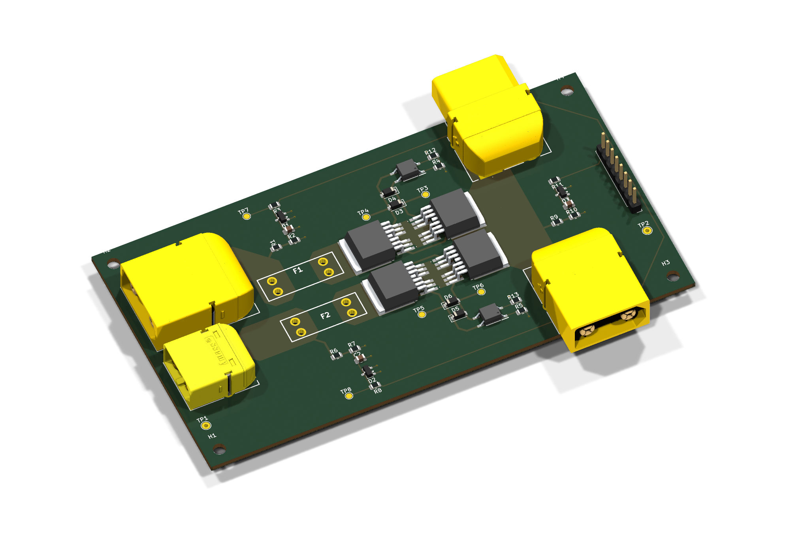
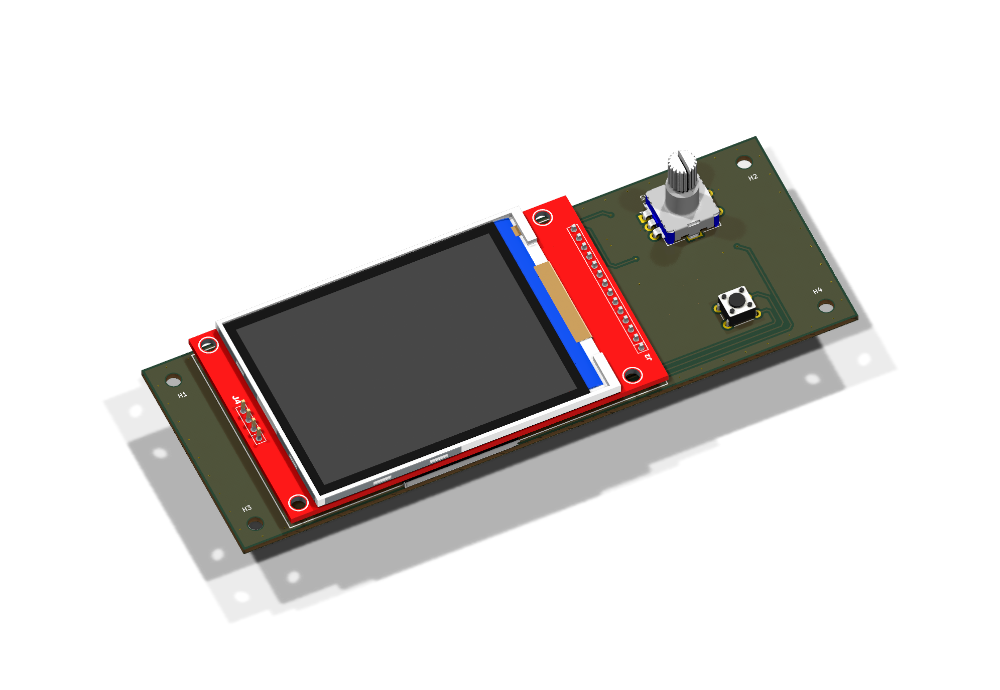

# Multi-Channel UAV Battery Discharger

> **Bakalářská práce:** Vícekanálová vybíječka akumulátorů pro bezpilotní letouny  
> **Pracoviště:** Skupina multirobotických systémů (MRS), FEL ČVUT v Praze  
> **Autor:** Adam Horák  
> **Vedoucí:** Tomáš Kestřánek

---

## 📌 O projektu
Cílem projektu je návrh, konstrukce a naprogramování inteligentního zařízení pro bezpečné a efektivní vybíjení sady akumulátorů do skladovacího (*storage*) napětí. Zařízení je optimalizováno pro laboratorní a terénní provoz bezpilotních letounů (UAV) skupiny MRS.

Klíčovou vlastností je plná automatizace – systém sám detekuje parametry připojených akumulátorů, spravuje frontu sekvenčního vybíjení a umožňuje vzájemné propojení více modulů pro sdílení zátěže (paralelní rozptyl výkonu do sousedního modulu).

### ⚙️ Klíčové technické parametry

| Parametr | Specifikace |
| :--- | :--- |
| **Podporovaná chemie** | Li-Po, Li-Ion |
| **Konfigurace článků** | 3S až 12S (napětí 10 V – 55 V) |
| **Kapacita portů** | 1 až 4 nezávislé baterie (výkonové XT60 / XT90) |
| **Vybíjecí výkon** | Min. 250 W (sekvenční vybíjení s prioritizací fronty) |
| **Řízení & automatizace** | Automatická detekce parametrů, plug & play storage režim |
| **Škálovatelnost** | Modulární propojení (sdílení zátěže mezi moduly) |
| **Bezpečnost** | HW i SW ochrany proti přebití/přehřátí, kompaktní kryt |

### 🎯 Rozšíření (volitelné cíle)
- [ ] Implementace pasivního balancování jednotlivých článků (BMS / balanční konektory)
- [ ] Doplňková funkce jednokanálového nabíjení

---

## 🖼️ Náhled hardwaru

### Přepínač kanálů ([hw/power-stage/](hw/power-stage/)) 

### Ovládací panel ([hw/ui-control-board-side/](hw/ui-control-board-side/))

---

## 📝 Aktuální stav
- [x] Návrh blokového schématu a rozdělení systému na funkční moduly (viz [náčrty v doc/sketches](doc/sketches/))
- [ ] Rozdělení na menší segmenty pro otestování - IN PROGRESS
